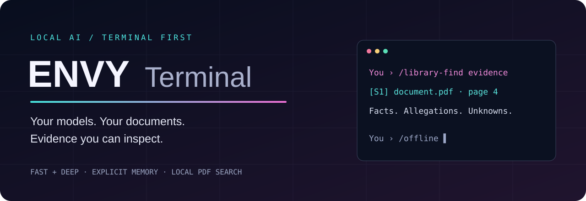
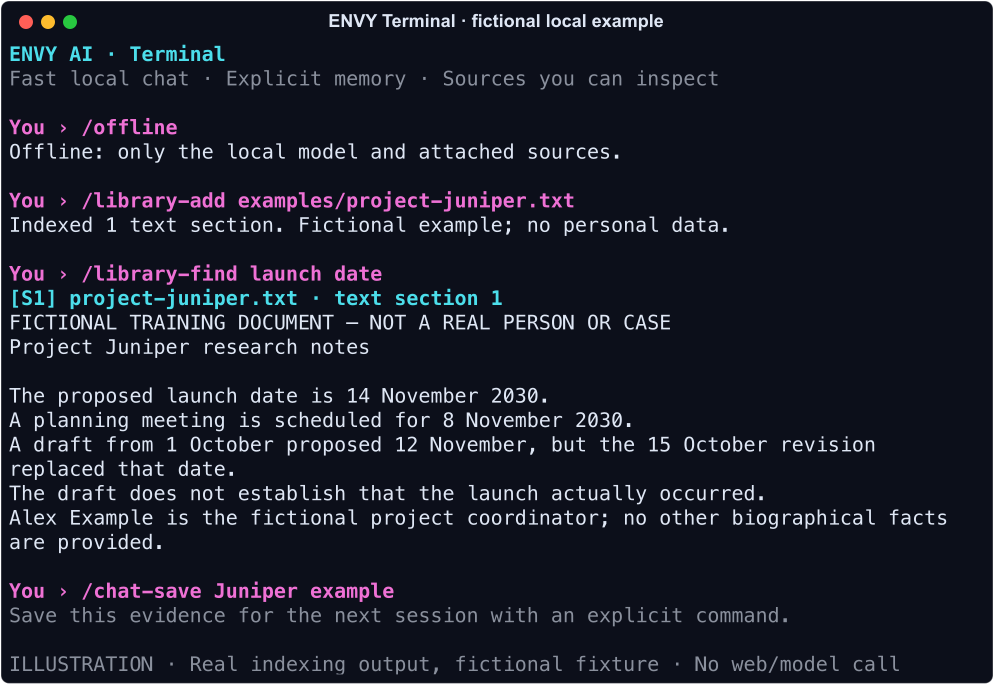

# ENVY Terminal

Local AI. Your Terminal. Sources you can inspect.

A macOS-first assistant for everyday questions, writing, document research, and public-record investigation. Run a fast local model or switch to Fable, search PDFs with page references, and save only the conversations you choose.



**Terminal only · local model inference · explicit memory · searchable PDFs · public-source research**

## Start here

Install [Ollama](https://ollama.com/download/mac), [uv](https://docs.astral.sh/uv/getting-started/installation/), and Git. Then, from this repository:

```sh
./scripts/setup.sh
./scripts/start.sh
```

Setup installs Python dependencies, downloads the fast model (~5.2 GB), starts Ollama on loopback port 11435, and builds local PDF OCR when Apple's command-line tools are available. It needs no administrator access and does not replace your default Ollama service.

For the optional Fable model (~29.8 GB download):

```sh
uv run --no-editable python scripts/install_fable.py
```

Read [setup and hardware guidance](docs/SETUP.md) before installing the larger model. Model weights are downloaded separately; they are not included in this repository.

## What you can do

| Task | In Terminal |
|---|---|
| Quick everyday questions | `/fast` |
| Detailed work with installed Fable | `/deep` |
| Save and resume a project | `/chat-save Project` then `/chat-load Project` |
| Remember a preference | `/remember Use short paragraphs` |
| Index a document | `/library-add ` then drag in a PDF |
| Search local evidence | `/library-find proposed launch date` |
| Investigate a public claim | `/check The project has already launched` |
| Research a person in context | `/person Alex Example, project coordinator` |
| Find public court records | `/court case name and jurisdiction` |
| Check citation references | `/audit` |
| Work without web research | `/offline` |

The person above and the supplied example document are fictional. `/person` researches relevant public information, checks identity, and separates facts from allegations; it does not promise access to all information about somebody.



*Illustrative terminal render generated from real library-search code and a fictional fixture. It is not a screenshot of a user's desktop or a claim of completed web research.*

## Read the guides

- [Complete command guide](docs/COMMANDS.md)
- [Installation, Fable, and hardware](docs/SETUP.md)
- [Researching people and checking evidence](docs/RESEARCH.md)
- [Default assistant instructions](docs/ASSISTANT_INSTRUCTIONS.md)
- [How the pieces fit together](docs/ARCHITECTURE.md)
- [Privacy, credentials, and data storage](docs/PRIVACY.md)
- [Setup history and troubleshooting](docs/TROUBLESHOOTING.md)
- [Tests and known limitations](docs/VALIDATION.md)

## Facts, costs, and boundaries

Local model inference has no provider token bill or daily provider message quota. Tokens still determine context capacity and processing work. Hardware, storage, electricity, website rate limits, and model limitations remain.

Online research contacts search engines and websites. Local inference is not a promise of anonymity. `/offline` disables ENVY's external research tools; it does not disconnect your whole computer.

CourtListener/RECAP offers public records with incomplete coverage. Optional CourtListener tokens are kept in macOS Keychain. PACER is a separate, potentially billable service: this project opens it for manual use and does not automate paid searches or purchases. Saving a PACER password does not create an automated PACER connection.

The models can make mistakes. Fable is a third-party refusal-reduced model, not a guarantee of unlimited capability or perfect accuracy. Citation checks verify that a source reference exists, not that every associated claim is true.

## Develop

```sh
uv sync --locked --no-editable --python 3.12
uv run --no-editable python -m unittest discover -s tests -v
uv run --no-editable python scripts/check_public.py
uv run --no-editable python scripts/render_demo.py
```

Tests run without personal credentials or model downloads. See [CONTRIBUTING.md](CONTRIBUTING.md) for how to keep examples free of personal data.

MIT for this project's code and documentation. Dependencies and separately downloaded models retain their own licenses; see [THIRD_PARTY.md](THIRD_PARTY.md).
