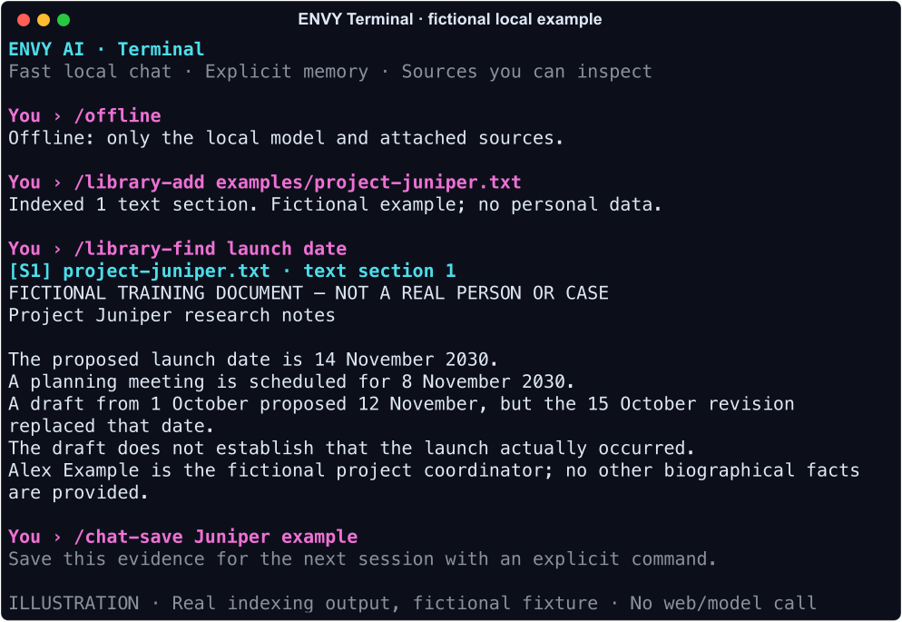

<p align="center">
  
</p>

<p align="center"><b>A local AI workspace that runs entirely in your Terminal.</b><br />
Fast answers, searchable documents and research with sources you can check yourself, on macOS, Windows and Linux.</p>

<p align="center">
  <a href="https://github.com/xzchick/envy-terminal/actions/workflows/tests.yml"></a>
</p>
<p align="center">
  
  
  <br />
  
  
  
</p>

<p align="center">
  <a href="#install"><b>Install</b></a> ·
  <a href="#works-on">Compatibility</a> ·
  <a href="#commands">Commands</a> ·
  <a href="#deep-mode">Deep mode</a> ·
  <a href="#your-data">Your data</a> ·
  <a href="#troubleshooting">Troubleshooting</a> ·
  <a href="#guides">Guides</a>
</p>

<a name="features"></a>




ENVY talks to a model running on **your own computer** through [Ollama](https://ollama.com). It runs its own Ollama service on `127.0.0.1:11435`, a loopback-only address, with cloud models turned off, so your chats and documents never leave the machine for inference. When you want it to, it can search the public web and read pages, and it keeps a numbered list of every source it used so you can check each one.

<a name="works-on"></a>


<p align="center">
  
  
  
</p>



<details>
<summary><b>Compatibility table as text</b></summary>

| Feature | macOS | Windows | Linux |
|---|:---:|:---:|:---:|
| Chat with fast and deep models | ✅ | ✅ | ✅ |
| Saved chats, preferences and exports | ✅ | ✅ | ✅ |
| Library search (PDF, TXT, MD, CSV) | ✅ | ✅ | ✅ |
| OCR for scanned PDFs | ✅ Apple Vision | — | — |
| Web search, page reading and citations | ✅ | ✅ | ✅ |
| Court records (CourtListener) and `/audit` | ✅ | ✅ | ✅ |
| Saved account tokens | macOS Keychain | Windows Credential Manager | Secret Service (GNOME Keyring, KWallet, KeePassXC) |
| Owner-only data folder | `0700` / `0600` | NTFS ACL: you, SYSTEM, Administrators | `0700` / `0600` |
| Launchers | `setup.sh`, `start.sh` | `setup.ps1`, `start.ps1` | `setup.sh`, `start.sh` |
| Standalone bundle (draft v0.1.0) | Apple Silicon (arm64) | x86_64 | x86_64 |
| Tested in CI on every push | ✅ | ✅ | ✅ |

On Windows and Linux, text-based PDFs work normally. Pages with no text layer, such as scans, are reported as unreadable instead of being treated as blank.

</details>

### Requirements

| | 🍎 macOS | 🪟 Windows | 🐧 Linux |
|---|---|---|---|
| **OS version** | macOS 14 Sonoma or newer | Windows 10 22H2 or Windows 11 | A current x86_64 or arm64 distribution |
| **Processor** | Apple Silicon (M1 or newer) recommended | 64-bit x86 | 64-bit x86 or ARM |
| **Graphics** | Metal, built in | NVIDIA or AMD speeds things up; the CPU also works | NVIDIA or AMD speeds things up; the CPU also works |
| **Memory** | 16 GB+ for fast mode · 64 GB+ for Fable | same | same |
| **Free disk** | ~6 GB for fast mode · ~65 GB extra for Fable | same | same |
| **Shell** | Terminal (zsh or bash) | PowerShell 5.1 or 7 ([Windows Terminal](https://aka.ms/terminal) recommended) | Any POSIX shell (sh, bash, zsh) |
| **Install first** | Ollama, uv, Git | Ollama, uv, Git | Ollama, uv, Git, curl |
| **Optional** | Xcode Command Line Tools (adds scanned-PDF OCR) | — | A Secret Service keyring (needed only to save account tokens) |
| **Python** | Nothing to install: uv downloads Python 3.12 | same | same |

> [!NOTE]
> The memory figures are starting points, not guarantees. Long documents, a large context and other open apps all use more memory.

<a name="install"></a>


You only need to run setup once. After that, run the start command whenever you want to use ENVY.

### 🍎 macOS

**1. Install the tools.** These commands give you Git and the Swift compiler for OCR, then uv. Get Ollama from **[ollama.com/download/mac](https://ollama.com/download/mac)** and open it once.

```sh
xcode-select --install
```

```sh
curl -LsSf https://astral.sh/uv/install.sh | sh
```

<sub>If you use Homebrew, you can run <code>brew install ollama uv git</code> instead. The scripts don't depend on Homebrew.</sub>

**2. Download ENVY and set it up.** Open a new Terminal window first so `uv` is on your PATH.

```sh
git clone https://github.com/xzchick/envy-terminal.git
cd envy-terminal
sh scripts/setup.sh
```

**3. Start it.**

```sh
sh scripts/start.sh
```

### 🪟 Windows

**1. Install the tools.** Run these in PowerShell. `winget` is built into Windows 10 and 11.

```powershell
winget install --id Git.Git -e
winget install --id astral-sh.uv -e
winget install --id Ollama.Ollama -e
```

<sub>Without winget: install <a href="https://git-scm.com/download/win">Git</a> and <a href="https://ollama.com/download/windows">Ollama</a> from their sites, and get uv with <code>powershell -ExecutionPolicy ByPass -c "irm https://astral.sh/uv/install.ps1 | iex"</code>.</sub>

**2. Download ENVY and set it up.** Close PowerShell and open a new window first so the new tools are found.

```powershell
git clone https://github.com/xzchick/envy-terminal.git
cd envy-terminal
powershell -ExecutionPolicy Bypass -File scripts\setup.ps1
```

**3. Start it.**

```powershell
powershell -ExecutionPolicy Bypass -File scripts\start.ps1
```

> [!TIP]
> `-ExecutionPolicy Bypass` applies to that one command only. It doesn't change your system's script policy.

### 🐧 Linux

**1. Install Git and curl** with your distribution's package manager:

| Distribution | Command |
|---|---|
| Ubuntu, Debian, Mint, Pop!_OS | `sudo apt update && sudo apt install -y git curl` |
| Fedora, RHEL, AlmaLinux, Rocky | `sudo dnf install -y git curl` |
| Arch, Manjaro, EndeavourOS | `sudo pacman -S --needed git curl` |
| openSUSE | `sudo zypper install -y git curl` |

**2. Install Ollama and uv** using their official install scripts:

```sh
curl -fsSL https://ollama.com/install.sh | sh
```

```sh
curl -LsSf https://astral.sh/uv/install.sh | sh
```

**3. Download ENVY and set it up.** Open a new terminal first so `uv` is on your PATH.

```sh
git clone https://github.com/xzchick/envy-terminal.git
cd envy-terminal
sh scripts/setup.sh
```

**4. Start it.**

```sh
sh scripts/start.sh
```

<details>
<summary><b>Saving account tokens on Linux (Secret Service keyring)</b></summary>

`/account-add` saves tokens only in a native keyring. It never falls back to a plain-text file. GNOME and KDE Plasma desktops usually have a keyring already. If yours doesn't:

| Desktop | What to use |
|---|---|
| GNOME, Cinnamon, XFCE, MATE | `gnome-keyring` (`sudo apt install gnome-keyring` or `sudo dnf install gnome-keyring`) |
| KDE Plasma | KWallet, which provides the Secret Service API on current Plasma versions |
| Any desktop | KeePassXC with its Secret Service integration turned on |
| Headless or SSH-only | No keyring: use `/court-auth` to enter a token for one session only |

Everything else in ENVY works without a keyring.

</details>

### What setup does

- Creates a private `.venv` from the locked dependency list, using Python 3.12 managed by uv.
- Creates your owner-only data folder (see [Your data](#your-data)).
- Starts, or reuses, Ollama on `127.0.0.1:11435` with `OLLAMA_NO_CLOUD=1`. It never replaces the Ollama service you may already run on port 11434.
- Downloads the fast model `qwen3:8b` (about 5.2 GB), or reuses a copy you already have.
- **macOS only:** builds the on-device `envy-ocr` helper with Apple Vision when the Xcode Command Line Tools are installed.

You don't need administrator access, apart from the Linux package installs above.

### Check your tools

If setup stops early, make sure each tool responds. Use the same commands on all three systems:

```sh
git --version
uv --version
ollama --version
```

### Prebuilt bundles (coming with v0.1.0)

The v0.1.0 release will include standalone bundles that don't need Python or uv; you install only Ollama. They're still a draft. When they're published, you'll download them from **Releases**:

| File | System |
|---|---|
| `envy-terminal-v0.1.0-macos-arm64.tar.gz` | macOS on Apple Silicon, including the OCR helper |
| `envy-terminal-v0.1.0-windows-x86_64.zip` | Windows on 64-bit x86 |
| `envy-terminal-v0.1.0-linux-x86_64.tar.gz` | Linux on 64-bit x86 |
| `envy_terminal-0.1.0-py3-none-any.whl` | Any OS with Python 3.12+ (`pip` or `uv`) |
| `SHA256SUMS.txt` | Checksums for every file above |

<details>
<summary><b>Verify and run a bundle</b></summary>

**macOS and Linux**

```sh
shasum -a 256 --ignore-missing -c SHA256SUMS.txt
tar -xzf envy-terminal-v0.1.0-<os>-<arch>.tar.gz
cd envy-terminal-v0.1.0-<os>-<arch>
sh ./setup-envy.sh
sh ./start-envy.sh
```

The bundle isn't signed, so macOS may quarantine it. Check its checksum first, then remove the quarantine flag with `xattr -dr com.apple.quarantine envy-terminal-v0.1.0-macos-*`.

**Windows PowerShell**

```powershell
$expected = (Select-String -Path .\SHA256SUMS.txt -Pattern 'envy-terminal-v0.1.0-windows-x86_64.zip').Line.Split(' ')[0]
$actual = (Get-FileHash .\envy-terminal-v0.1.0-windows-x86_64.zip -Algorithm SHA256).Hash.ToLower()
if ($actual -ne $expected) { throw "SHA-256 mismatch: $actual != $expected" } else { "SHA-256 verified: $actual" }
Expand-Archive .\envy-terminal-v0.1.0-windows-x86_64.zip -DestinationPath .
cd .\envy-terminal-v0.1.0-windows-x86_64
powershell -ExecutionPolicy Bypass -File .\setup-envy.ps1
powershell -ExecutionPolicy Bypass -File .\start-envy.ps1
```

</details>

<a name="deep-mode"></a>


`/fast` uses Qwen3 8B, which is small and quick. `/deep` switches to **Fable**, a larger third-party model (Qwen3.8 27B, Q8_0) for longer, more detailed work. Fable is optional and installed separately. Read the [publisher's model card](https://huggingface.co/DavidAU/Qwen3.8-27B-TWIN-TURBO-Fable-Cold-Fusion-709-ULTRA-HERETIC-Uncensored-NM-DAU-NEO-MTP-GGUF) first for its license and limitations.

**macOS and Linux**

```sh
sh scripts/start.sh --serve-only
uv run --no-editable python scripts/install_fable.py
```

**Windows PowerShell**

```powershell
powershell -ExecutionPolicy Bypass -File scripts\start.ps1 -ServeOnly
uv run --no-editable python scripts/install_fable.py
```

The installer asks before it downloads anything. It pins one model revision, checks its SHA-256 and imports it into Ollama as `envy-fable`. The download is about **29.8 GB**; leave about **65 GB** free, because Hugging Face and Ollama may each keep a copy. It needs no Hugging Face token.

Type `/deep` in ENVY to use it and `/fast` to switch back. The first answer after a switch is slower while the model loads.

> [!IMPORTANT]
> Fable is refusal-reduced, but it can still refuse, misunderstand or get facts wrong. Neither mode offers unlimited context.

<a name="commands"></a>


Type commands at the `You ›` prompt. Anything that isn't a command goes to the model as a chat message. Commands run only when you type them, never because a model or a web page asked for one. To add a file, drag it into the terminal window from Finder, File Explorer or your file manager; it pastes the path, and paths with spaces can be quoted.

#### Chat and speed

| Command | What it does |
|---|---|
| `/help` | Shows the built-in help |
| `/fast` | Switches to Qwen3 8B, the default; your choice is remembered |
| `/deep` | Switches to the installed Fable model; your choice is remembered |
| `/new` | Starts a fresh chat and source list, keeping your preferences and account session |
| `/quit` · `/exit` · `/bye` | Exits without saving the conversation |
| <kbd>Ctrl</kbd>+<kbd>C</kbd> | Stops the current request and returns to the prompt |

#### Saved chats and memory

| Command | What it does |
|---|---|
| `/chats` | Lists your saved chats |
| `/chat-save Name` | Saves the chat and its sources; asks before overwriting |
| `/chat-load Name` | Reopens a saved chat; asks before replacing unsaved messages |
| `/chat-delete Name` | Deletes a saved chat after confirming |
| `/save path/export.json` | Exports messages and sources to a new file; never overwrites |
| `/remember text` | Saves a preference, which isn't a secret, that ENVY includes in future prompts |
| `/preferences` | Lists saved preferences with numbers |
| `/forget 1` · `/forget all` | Deletes one preference, or all of them after confirming |

#### Documents

| Command | What it does |
|---|---|
| `/file path/document.pdf` | Attaches a file to this chat, starting with its first five PDF pages |
| `/library-add path/document.pdf` | Indexes the whole file for local keyword search |
| `/library` | Lists indexed documents with their IDs and page counts |
| `/library-find words` | Finds matching pages or sections and lists them as sources |
| `/library-remove ID` | Removes an index after confirming; your original file stays |
| `/sources` | Shows every source used in this chat |

The library takes PDF, TXT, MD and CSV files up to 200 MB each; web downloads are limited to 50 MB. If a document changes, index it again.

#### Research and verification

| Command | What it does |
|---|---|
| `/search terms` | Searches the public web and has the model open and cite sources |
| `/read https://…` | Reads one public page or PDF as evidence |
| `/court case and jurisdiction` | Searches public CourtListener/RECAP records |
| `/person name, context` | Researches relevant public information, tells apart people with the same name and cites sources |
| `/check claim` | Builds an evidence table of support, contradictions and open questions |
| `/audit` | Checks the source IDs in the last answer for missing or snippet-only citations |
| `/offline` · `/online` | Turns web research off or back on; library search still works offline |

#### Accounts

| Command | What it does |
|---|---|
| `/account-add courtlistener` | Saves a CourtListener API token, typed at a hidden prompt, to your OS keychain |
| `/account-use courtlistener` | Turns on the saved token for this session |
| `/court-auth` | Uses a token for this session only, without saving it |
| `/account-add pacer` | Saves a PACER login to your keychain; ENVY never signs in or buys anything automatically |
| `/accounts` | Lists saved account names and websites, never the secrets |
| `/account-remove courtlistener` | Deletes a saved credential (also works for `pacer`) |
| `/pacer` | Shows the fee notice, then opens the official PACER site in your browser |

#### Try it: a first offline session

The Project Juniper example is fictional. It contains a draft date and a revised date that conflict, so you can see how ENVY handles evidence.

```text
/offline
/library-add examples/project-juniper.txt
/library-find launch date
What proposed date does the document give, and does it prove the launch happened? Cite the source.
/audit
/chat-save Juniper example
/quit
```

The next time you start ENVY, run `/chat-load Juniper example` to pick up where you left off. More detail is in the [complete command guide](docs/COMMANDS.md).



<sub>This image was rendered by the real library-search code from a fictional fixture. It's not a screenshot of anyone's desktop or of finished web research.</sub>

<a name="your-data"></a>


| | Data folder | Saved tokens | Protection |
|---|---|---|---|
| 🍎 **macOS** | `~/Library/Application Support/ENVY Terminal/` | macOS Keychain | Folders `0700`, files `0600` |
| 🪟 **Windows** | `%LOCALAPPDATA%\ENVY Terminal\` | Windows Credential Manager | NTFS ACL that allows only you, SYSTEM and Administrators |
| 🐧 **Linux** | `$XDG_DATA_HOME/envy-terminal/`, which defaults to `~/.local/share/envy-terminal/` | Secret Service keyring | Folders `0700`, files `0600` |

| What | Where it goes |
|---|---|
| Your prompts and the model's answers | Your local Ollama only |
| Web search keywords | Search providers, only while you're online |
| A URL you ask ENVY to read | That website and any redirects it allows |
| Indexed documents and OCR text | A local SQLite index in your data folder |
| Saved chats and preferences | Local JSON files in your data folder |
| Account tokens | Your OS keychain, never chat history or exports |

ENVY doesn't encrypt these files itself, so your OS, backups and exports may keep copies. `/offline` turns off ENVY's web tools, but it doesn't disconnect your computer. Running a model locally doesn't make you anonymous online. See [Privacy](docs/PRIVACY.md) for details.

<a name="configure"></a>


All settings are optional. The `.env.example` file lists them, but ENVY doesn't load it automatically; set them in your shell before you start ENVY.

| Variable | Default | What it sets |
|---|---|---|
| `ENVY_OLLAMA_URL` | `http://127.0.0.1:11435` | The Ollama address; loopback addresses only |
| `ENVY_FAST_MODEL` | `qwen3:8b` | The model `/fast` uses |
| `ENVY_DEEP_MODEL` | `envy-fable` | The model `/deep` uses |
| `ENVY_DATA_DIR` | your OS data folder + `/data` | Where chats, preferences and the index are stored |
| `ENVY_OCR` | the built `envy-ocr` helper | The path to an OCR helper |
| `ENVY_SKIP_PULL=1` | off | Makes setup skip the model download |

**Example: use an Ollama you already run on port 11434.** The start scripts work only with port 11435, so run ENVY directly instead:

**macOS and Linux**

```sh
export ENVY_OLLAMA_URL=http://127.0.0.1:11434
uv run --locked --no-editable envy
```

**Windows PowerShell**

```powershell
$env:ENVY_OLLAMA_URL = 'http://127.0.0.1:11434'
uv run --locked --no-editable envy
```

### Update

```sh
git pull
uv sync --locked --no-editable
```

### Uninstall

1. In ENVY, run `/account-remove courtlistener` and `/account-remove pacer` to delete saved credentials.
2. Delete the `envy-terminal` folder, which includes `.venv`.
3. Delete your data folder (see [Your data](#your-data)), along with any exports you saved.
4. Models are shared with other Ollama apps, so remove them yourself if you no longer need them: `ollama rm envy-fable` and `ollama rm qwen3:8b`.

<a name="troubleshooting"></a>


| Problem | Fix |
|---|---|
| `uv` or `ollama` not found | Open a **new** terminal window after installing them, then run `uv --version` and `ollama --version`. |
| Windows says scripts are disabled | Run the scripts exactly as shown, with `powershell -ExecutionPolicy Bypass -File …`. |
| "Ollama did not start" | Read `ollama.log` in your data folder. On Windows, also read `ollama.log.err`. |
| "Model not found" | Run setup again. For `/deep`, run `scripts/install_fable.py` first. |
| The first answer is slow | The model is loading into memory; later answers reuse it for 30 minutes. `/fast` is lighter. |
| A scanned PDF has no text | On macOS, run `xcode-select --install` and then setup again to build OCR. Windows and Linux read text PDFs only. |
| Linux: "credential store is unavailable" | Start a Secret Service keyring (see the Linux section) or use `/court-auth`. |
| macOS blocks a downloaded bundle | Verify `SHA256SUMS.txt`, then run `xattr -dr com.apple.quarantine <folder>`. |
| A site returns 403, 429 or a login page | That's access denied or rate limiting. Open the site yourself, download the document and use `/file`. |

**Is ENVY's Ollama running?**

**macOS and Linux**

```sh
sh scripts/start.sh --serve-only
curl --noproxy '*' -fsS http://127.0.0.1:11435/api/version
curl --noproxy '*' -fsS http://127.0.0.1:11435/api/tags
```

**Windows PowerShell**

```powershell
powershell -ExecutionPolicy Bypass -File scripts\start.ps1 -ServeOnly
Invoke-RestMethod http://127.0.0.1:11435/api/version
Invoke-RestMethod http://127.0.0.1:11435/api/tags
```

The full list, including the history of fixes, is in [Troubleshooting](docs/TROUBLESHOOTING.md).

<a name="develop"></a>


These commands are the same on all three systems. CI runs them on Ubuntu, Windows and macOS for every push.

```sh
uv sync --locked --no-editable --python 3.12
uv run --no-editable python -m unittest discover -s tests -v
uv run --no-editable python scripts/check_public.py
uv run --no-editable python scripts/build_release_bundle.py
uv run --no-editable python scripts/smoke_test_release.py
```

<details>
<summary><b>Installer smoke checks and artwork</b></summary>

```sh
# macOS and Linux: set up without starting Ollama or downloading models
ENVY_SKIP_SERVE=1 ENVY_SKIP_PULL=1 sh scripts/setup.sh
```

```powershell
# Windows
./scripts/setup.ps1 -SkipModels -SkipServe
```

```sh
# Regenerate the README artwork and the terminal demo image
python scripts/render_readme_art.py
uv run --no-editable python scripts/render_demo.py
```

</details>

The tests need no personal credentials or model downloads. Keep examples free of personal data; [CONTRIBUTING.md](CONTRIBUTING.md) explains how.

<a name="guides"></a>


| Guide | What's inside |
|---|---|
| [Setup](docs/SETUP.md) | Installation details, Fable and hardware |
| [Commands](docs/COMMANDS.md) | Every command, with notes |
| [Research](docs/RESEARCH.md) | Researching people and checking evidence |
| [Assistant instructions](docs/ASSISTANT_INSTRUCTIONS.md) | The default system prompt |
| [Architecture](docs/ARCHITECTURE.md) | How the pieces fit together |
| [Privacy](docs/PRIVACY.md) | Credentials and data storage |
| [Troubleshooting](docs/TROUBLESHOOTING.md) | Problems already solved |
| [Validation](docs/VALIDATION.md) | Tests and known limitations |
| [Release notes](RELEASE_NOTES.md) | v0.1.0 bundles and checksums |

### Facts, costs and limits

- **No token bill.** A local model has no per-token charge or daily message limit. You still pay for the hardware, storage and electricity, and context size is still limited.
- **The models make mistakes.** `/audit` checks that a cited source exists, not that the claim is true. Read the original pages.
- **Public records are incomplete.** CourtListener/RECAP doesn't cover everything. PACER is a separate service that may charge fees; ENVY only opens it for you to use yourself.
- **`/person` uses public information.** It doesn't promise to find everything about someone, and it doesn't build files of private details.

<p align="center"><sub>MIT for this project's code and docs. Dependencies and models you download separately keep their own licenses; see <a href="THIRD_PARTY.md">THIRD_PARTY.md</a>.</sub></p>
