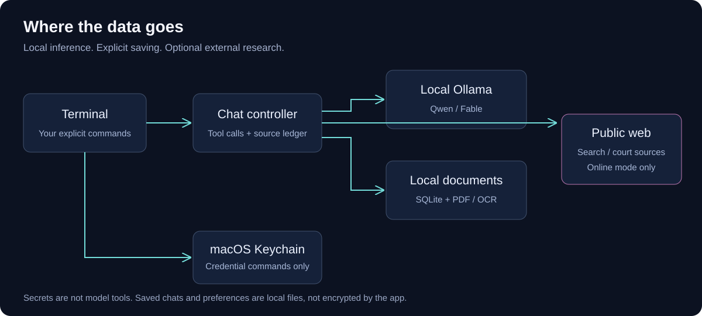
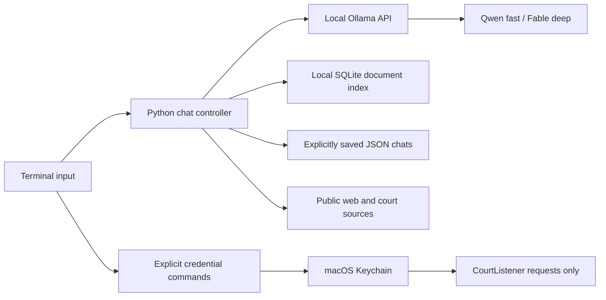

# Architecture

`src/envy_terminal/cli.py` manages the interactive prompt, local model calls, read-only research tools, source IDs, and citation auditing. `features.py` manages explicit persistence, full-text document search, and credentials. `scripts/envy-ocr.swift` uses PDFKit and Vision for local OCR.

No model tool can execute shell commands, enroll credentials, save/delete chats, or browse arbitrary local files. Users attach files or add them to the library explicitly. Tool outputs are treated as evidence, not instructions.

A conversation stays in memory until `/chat-save` or `/save`. Preferences and mode changes persist when explicitly requested. Saved chats retain source extracts; removing a library entry does not remove those copies.

FTS5 ranks keyword matches from indexed pages/sections. No hosted embedding service is involved. Each indexed file has a content-derived ID and each source records retrieval time. A library result is an indexed snapshot; it is not a live view of a changing file. PDF page numbers are physical PDF positions, which may differ from printed page numbers.

The chat controller streams responses and requests no hidden thinking output. It keeps the model warm for 30 minutes and preserves a 32K model context configuration. Older conversation/tool text is trimmed using a character budget, not an exact tokenizer; very large or token-dense messages can still exceed context. Sessions are not unlimited memory.

Public HTTP requests reject credentials in URLs and private/local DNS addresses, check redirects, and have download limits. These checks reduce accidental local-network access; this client is not a hardened proxy for adversarial networks, DNS rebinding, or untrusted multi-user hosting. Run it as a personal local application.

Keychain access is isolated from the model tool list. A CourtListener token is sent only to the fixed CourtListener API host. PACER credential storage is available, but automatic PACER authentication and billable record requests are not implemented.
